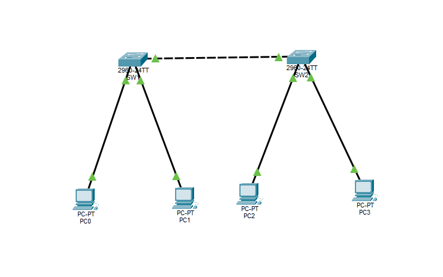
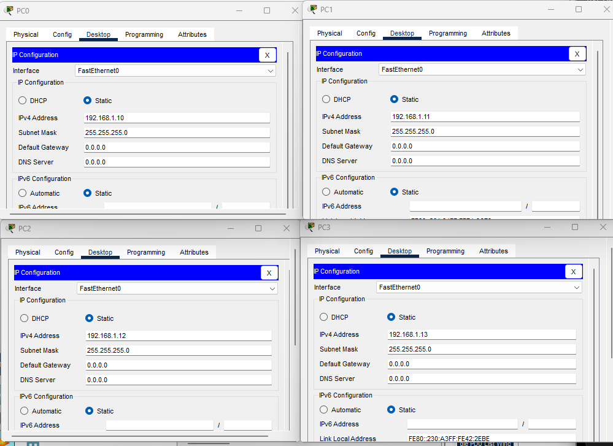
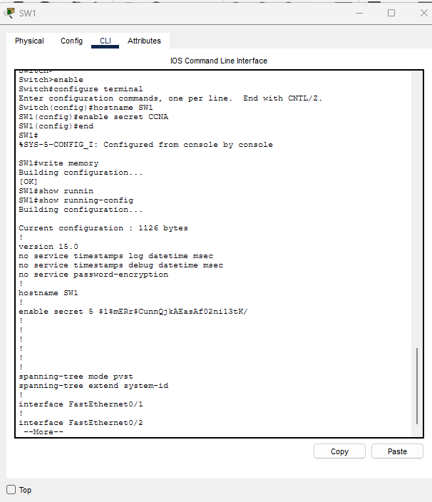
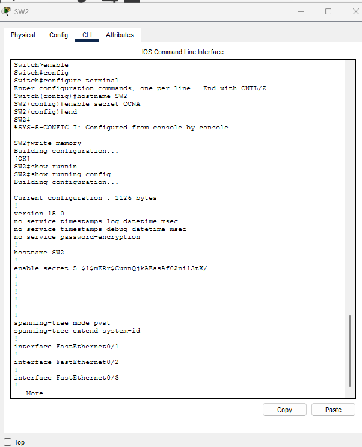
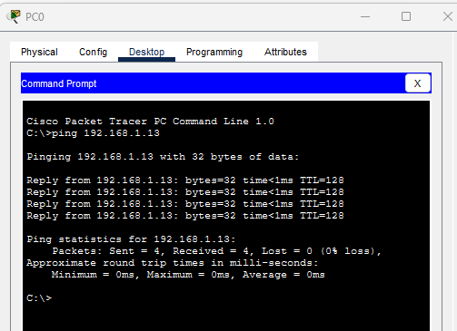
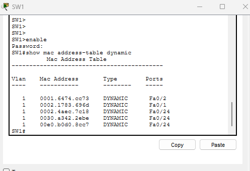

# Lab 01 – Ethernet LAN Switching

## Objective

Build and configure a small Ethernet LAN using two Cisco 2960 switches and four PCs. Verify end-to-end connectivity and inspect the switches' dynamically learned MAC address table.

## Tools and Components

| Component | Quantity |
|---|---:|
| Cisco 2960 switch | 2 |
| PC-PT | 4 |
| Copper Straight-Through cable | 6 |
| Cisco Packet Tracer | 1 |

## Network Topology

Two switches are connected through FastEthernet0/24. Each switch connects to two PCs.



### Cable Connections

| Device A | Port | Device B | Port |
|---|---|---|---|
| PC0 | FastEthernet0 | SW1 | Fa0/1 |
| PC1 | FastEthernet0 | SW1 | Fa0/2 |
| SW1 | Fa0/24 | SW2 | Fa0/24 |
| PC2 | FastEthernet0 | SW2 | Fa0/1 |
| PC3 | FastEthernet0 | SW2 | Fa0/2 |

All links use Copper Straight-Through cables.

## IP Addressing

| Device | IPv4 address | Subnet mask |
|---|---|---|
| PC0 | 192.168.1.10 | 255.255.255.0 |
| PC1 | 192.168.1.11 | 255.255.255.0 |
| PC2 | 192.168.1.12 | 255.255.255.0 |
| PC3 | 192.168.1.13 | 255.255.255.0 |

All PCs are in the same subnet. A default gateway is not required for communication within this LAN.



## Switch Configuration

The hostname and privileged EXEC password were configured on both switches.

### SW1

```cisco
enable
configure terminal
hostname SW1
enable secret CCNA
end
write memory
```



### SW2

```cisco
enable
configure terminal
hostname SW2
enable secret CCNA
end
write memory
```



The `enable secret` command protects access to privileged EXEC mode. The password shown here is for this Packet Tracer practice lab only; do not reuse it for real systems.

## Connectivity Verification

From PC0, connectivity to PC3 was tested with:

```text
ping 192.168.1.13
```

The captured test shows successful replies with 4 packets received and 0% packet loss.



## MAC Address Learning

The dynamically learned MAC address table was inspected on SW1 using:

```cisco
show mac address-table dynamic
```



The switch learns source MAC addresses from received Ethernet frames and associates them with the ports on which those frames arrive. The table can include entries learned from PCs and from devices reachable through the inter-switch link.

## Concepts Practised

- Ethernet LAN topology and cabling
- Basic Cisco switch CLI navigation
- Hostname configuration
- Privileged EXEC password using `enable secret`
- Static IPv4 configuration on end devices
- ICMP ping connectivity testing
- Dynamic MAC address learning and MAC address table inspection


