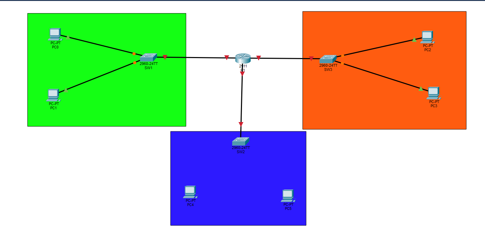
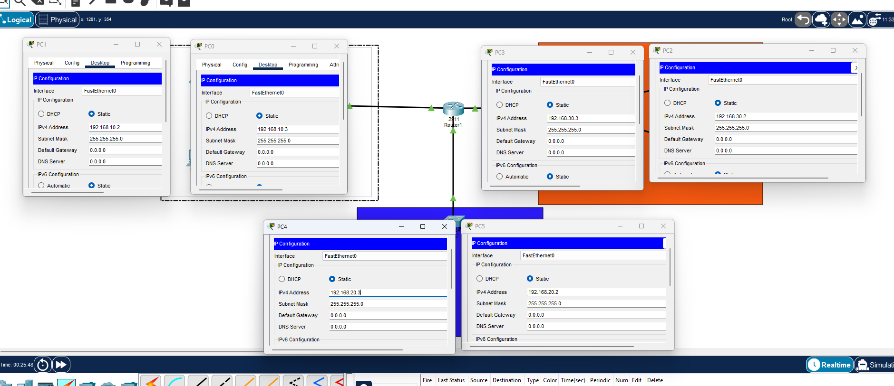
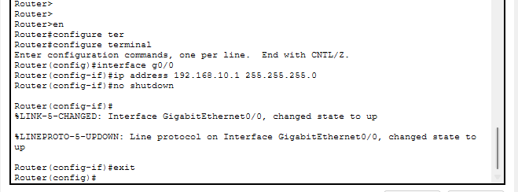
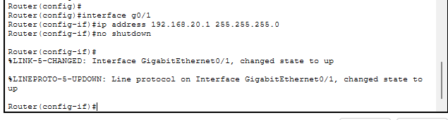
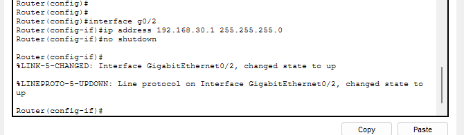
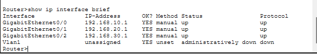
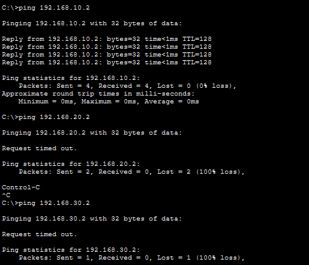

# Lab 02 – Three LAN Router Configuration

## Objective

Build and configure three separate Ethernet LANs using one Cisco 2911 router, three Cisco 2960 switches and six PCs. Assign different IPv4 subnets to each LAN, configure router interfaces as default gateways, and verify connectivity between the networks using ICMP ping tests.

## Tools and Components

| Component | Quantity |
|---|---:|
| Cisco 2911 Router | 1 |
| Cisco 2960 Switch | 3 |
| PC-PT | 6 |
| Copper Straight-Through cable | 9 |
| Cisco Packet Tracer | 1 |

## Network Topology

One router connects three independent LANs through three GigabitEthernet interfaces. Each LAN contains one Cisco 2960 switch connected to two PCs.



### Network Connections

| Device A | Router Port | Device B |
|---|---|---|
| R1 | GigabitEthernet0/0 | SW1 |
| R1 | GigabitEthernet0/1 | SW2 |
| R1 | GigabitEthernet0/2 | SW3 |

Each switch connects to two PCs using Copper Straight-Through cables.

## IP Addressing

Three different IPv4 subnets were configured, one for each LAN.

| LAN | Device | IPv4 Address | Subnet Mask | Default Gateway |
|---|---|---|---|---|
| Green | R1 (G0/0) | 192.168.10.1 | 255.255.255.0 | — |
| Green | PC0 | 192.168.10.3 | 255.255.255.0 | 192.168.10.1 |
| Green | PC1 | 192.168.10.2 | 255.255.255.0 | 192.168.10.1 |
| Blue | R1 (G0/1) | 192.168.20.1 | 255.255.255.0 | — |
| Blue | PC4 | 192.168.20.3 | 255.255.255.0 | 192.168.20.1 |
| Blue | PC5 | 192.168.20.2 | 255.255.255.0 | 192.168.20.1 |
| Orange | R1 (G0/2) | 192.168.30.1 | 255.255.255.0 | — |
| Orange | PC2 | 192.168.30.2 | 255.255.255.0 | 192.168.30.1 |
| Orange | PC3 | 192.168.30.3 | 255.255.255.0 | 192.168.30.1 |

All PCs use the subnet mask `255.255.255.0`.



## Router Configuration

The router was configured with three separate GigabitEthernet interfaces. Each interface acts as the default gateway for its respective LAN.

### Router R1 – Initial Configuration

```cisco
enable
configure terminal
hostname R1
```

### Interface G0/0 – Green LAN

```cisco
interface gigabitEthernet 0/0
description GREEN_LAN_SW1
ip address 192.168.10.1 255.255.255.0
no shutdown
exit
```



### Interface G0/1 – Blue LAN

```cisco
interface gigabitEthernet 0/1
description BLUE_LAN_SW2
ip address 192.168.20.1 255.255.255.0
no shutdown
exit
```



### Interface G0/2 – Orange LAN

```cisco
interface gigabitEthernet 0/2
description ORANGE_LAN_SW3
ip address 192.168.30.1 255.255.255.0
no shutdown
exit
```



### Save Configuration

```cisco
end
copy running-config startup-config
```

## Router Interface Verification

The router interfaces were verified using:

```cisco
show ip interface brief
```

The captured output confirms that all three GigabitEthernet interfaces are operational.

| Interface | IPv4 Address | Status | Protocol |
|---|---|---|---|
| G0/0 | 192.168.10.1 | up | up |
| G0/1 | 192.168.20.1 | up | up |
| G0/2 | 192.168.30.1 | up | up |



## Connectivity Verification

ICMP ping commands were used to test communication between PCs in the same LAN and across different LANs.

### Same LAN Communication

From PC0 to PC1:

```cmd
ping 192.168.10.2
```

Result: Successful. Four packets received with 0% packet loss.

### Green LAN to Blue LAN

From PC0 to PC5:

```cmd
ping 192.168.20.2
```

Result: Unsuccessful in the captured test.

### Green LAN to Orange LAN

From PC0 to PC2:

```cmd
ping 192.168.30.2
```

Result: Unsuccessful in the captured test.



**Troubleshooting Note:** The captured PC IP configuration shows default gateways as `0.0.0.0`. The correct gateway addresses must be configured on all six PCs before successful inter-LAN communication can be verified.

## Concepts Practised

- Cisco Router CLI Configuration
- GigabitEthernet Interface Configuration
- IPv4 Addressing and Subnet Masks
- Three Separate LAN Networks
- Default Gateway Configuration
- Router-Based Inter-LAN Routing
- Interface Status Verification
- ICMP Ping Connectivity Testing
- Basic Network Troubleshooting


