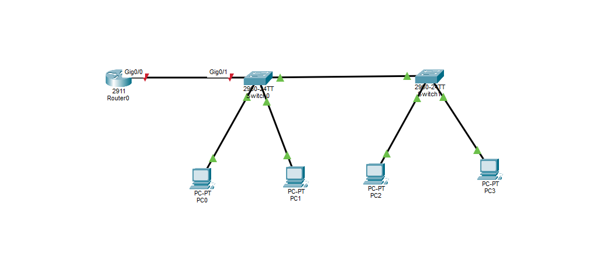
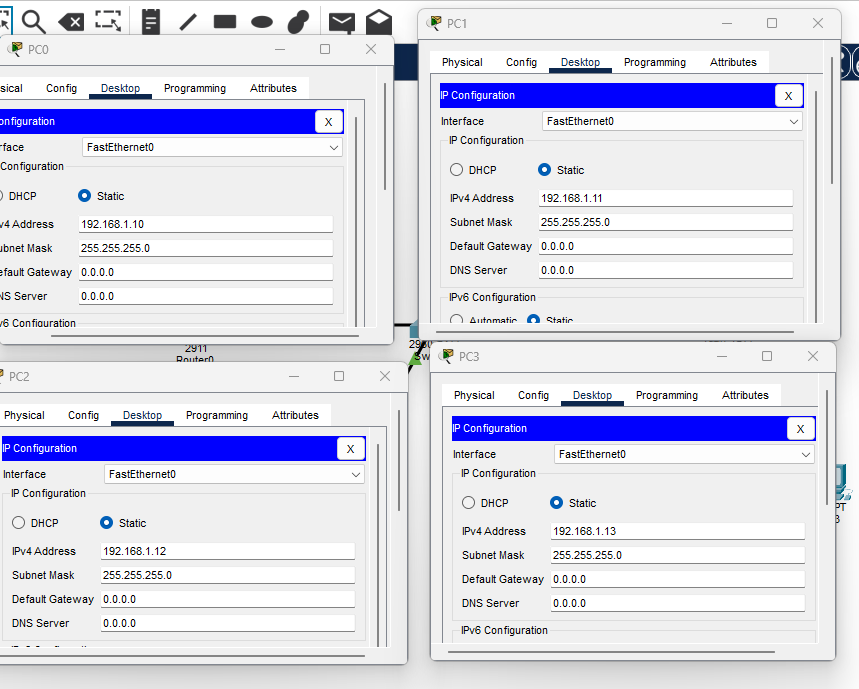
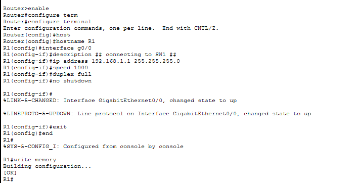
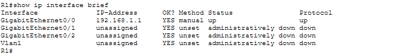
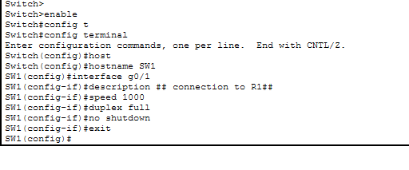
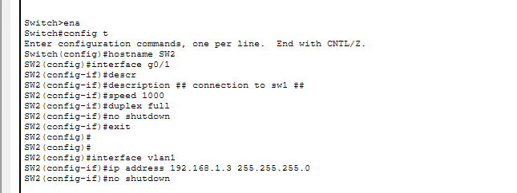
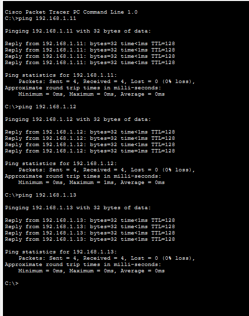

# Lab 03 – Router and Switch Configuration

## Objective

Build and configure a small Ethernet LAN using one Cisco 2911 router, two Cisco 2960 switches and four PCs. Configure router and switch hostnames, IP addressing, interface speed, duplex mode, interface descriptions and interface activation. Configure static IPv4 addresses on all PCs and verify network connectivity.

## Tools and Components

| Component | Quantity |
|---|---:|
| Cisco 2911 Router | 1 |
| Cisco 2960 Switch | 2 |
| PC-PT | 4 |
| Copper Straight-Through cable | 6 |
| Cisco Packet Tracer | 1 |

## Network Topology

One router is connected to Switch 1. Switch 1 is connected to Switch 2, with two PCs connected to each switch.



### Cable Connections

| Device A | Port | Device B | Port |
|---|---|---|---|
| Router R1 | GigabitEthernet0/0 | SW1 | GigabitEthernet0/1 |
| SW1 | GigabitEthernet0/2 | SW2 | GigabitEthernet0/1 |
| PC0 | FastEthernet0 | SW1 | Fa0/1 |
| PC1 | FastEthernet0 | SW1 | Fa0/2 |
| PC2 | FastEthernet0 | SW2 | Fa0/1 |
| PC3 | FastEthernet0 | SW2 | Fa0/2 |

All links use Copper Straight-Through cables.

## IP Addressing

| Device | Interface | IPv4 Address | Subnet Mask |
|---|---|---|---|
| R1 | GigabitEthernet0/0 | 192.168.1.1 | 255.255.255.0 |
| SW1 | VLAN 1 | 192.168.1.2 | 255.255.255.0 |
| SW2 | VLAN 1 | 192.168.1.3 | 255.255.255.0 |
| PC0 | FastEthernet0 | 192.168.1.10 | 255.255.255.0 |
| PC1 | FastEthernet0 | 192.168.1.11 | 255.255.255.0 |
| PC2 | FastEthernet0 | 192.168.1.12 | 255.255.255.0 |
| PC3 | FastEthernet0 | 192.168.1.13 | 255.255.255.0 |

All devices are configured within the same subnet (192.168.1.0/24). The router acts as the default gateway (192.168.1.1).



## Router Configuration

The router hostname, interface IP address, interface description, speed, duplex mode and interface activation were configured.

### R1

```cisco
enable
configure terminal
hostname R1

interface gigabitEthernet 0/0
description Connection_to_SW1
ip address 192.168.1.1 255.255.255.0
speed 1000
duplex full
no shutdown
exit

end
write memory
```



### Router Interface Verification

The router interface configuration was verified using:

```cisco
show ip interface brief
```

The GigabitEthernet0/0 interface is configured with the IP address 192.168.1.1.



## Switch Configuration

Both switches were configured with unique hostnames, interface descriptions, speed, duplex mode, management IP addresses and active interfaces.

### SW1

```cisco
enable
configure terminal
hostname SW1

interface gigabitEthernet 0/1
description Connection_to_R1
speed 1000
duplex full
no shutdown
exit

interface gigabitEthernet 0/2
description Connection_to_SW2
speed 1000
duplex full
no shutdown
exit

interface range fastEthernet 0/1-2
description Connections_to_PC0_and_PC1
speed 100
duplex full
no shutdown
exit

interface vlan 1
ip address 192.168.1.2 255.255.255.0
no shutdown
exit

ip default-gateway 192.168.1.1

end
write memory
```



### SW2

```cisco
enable
configure terminal
hostname SW2

interface gigabitEthernet 0/1
description Connection_to_SW1
speed 1000
duplex full
no shutdown
exit

interface range fastEthernet 0/1-2
description Connections_to_PC2_and_PC3
speed 100
duplex full
no shutdown
exit

interface vlan 1
ip address 192.168.1.3 255.255.255.0
no shutdown
exit

ip default-gateway 192.168.1.1

end
write memory
```



The `hostname` command identifies each network device. The `description` command documents the purpose of an interface. The `speed` and `duplex` commands configure interface operation, while `no shutdown` enables the interface.

VLAN 1 is used for switch management, and the default gateway allows the switches to communicate with devices outside their local subnet.

## PC Configuration

All four PCs were configured using Desktop → IP Configuration in Cisco Packet Tracer.

Static IPv4 addresses and subnet masks were assigned through the graphical interface.

- PC0 – 192.168.1.10
- PC1 – 192.168.1.11
- PC2 – 192.168.1.12
- PC3 – 192.168.1.13

Default Gateway: 192.168.1.1


## Connectivity Verification

Network connectivity between the PCs and router was tested using the ping command from the PC Command Prompt.

```text
ping 192.168.1.11
ping 192.168.1.12
ping 192.168.1.13
ping 192.168.1.1
```

These tests verify connectivity between devices connected to both switches and the router.



## Concepts Practised

- Basic Cisco router configuration
- Basic Cisco switch configuration
- Network topology design using Cisco Packet Tracer
- Hostname configuration
- Interface IP addressing
- Subnet mask configuration
- Interface speed and duplex configuration
- Interface descriptions
- Interface activation using `no shutdown`
- Switch management through VLAN 1
- Default gateway configuration
- Static IPv4 configuration on end devices
- ICMP ping connectivity testing
- Basic Ethernet LAN communication
