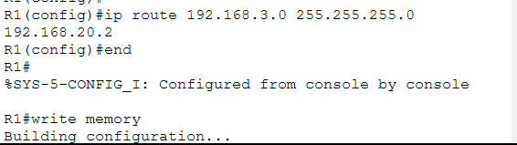

# Lab 02 -- Static Routing Between Three Routers

## Objective

Construct a three-router network in Cisco Packet Tracer, configure IPv4
addresses on router interfaces and end devices, implement static routes,
and verify end-to-end connectivity between two LANs.

## Tools and Components

  Component                  Quantity
  ------------------------ ----------
  Cisco 2911 router                 3
  PC-PT                             2
  Copper Ethernet cables            4
  Cisco Packet Tracer               1

## Network Topology

The topology contains three routers connected in a linear path. PC1 is
connected to R1, and PC2 is connected to R3. R2 acts as the intermediate
router between the two LANs.


### Cable Connections

  Device A   Interface            Device B   Interface
  ---------- -------------------- ---------- --------------------
  PC1        FastEthernet0        R1         GigabitEthernet0/1
  R1         GigabitEthernet0/0   R2         GigabitEthernet0/0
  R2         GigabitEthernet0/1   R3         GigabitEthernet0/0
  R3         GigabitEthernet0/1   PC2        FastEthernet0

The router-to-router links use separate point-to-point Ethernet
connections. The PCs are directly connected to the edge routers in this
initial version of the lab; switches can be added in a later topology
revision.

## IP Addressing

All interfaces use the subnet mask `255.255.255.0` (`/24`).

  Network                       Device   Interface            IPv4 address
  ----------------------------- -------- -------------------- -----------------
  LAN 1 -- `192.168.1.0/24`     PC1      FastEthernet0        `192.168.1.1`
  LAN 1 -- `192.168.1.0/24`     R1       GigabitEthernet0/1   `192.168.1.254`
  R1--R2 -- `192.168.20.0/24`   R1       GigabitEthernet0/0   `192.168.20.1`
  R1--R2 -- `192.168.20.0/24`   R2       GigabitEthernet0/0   `192.168.20.2`
  R2--R3 -- `192.168.21.0/24`   R2       GigabitEthernet0/1   `192.168.21.2`
  R2--R3 -- `192.168.21.0/24`   R3       GigabitEthernet0/0   `192.168.21.3`
  LAN 2 -- `192.168.3.0/24`     R3       GigabitEthernet0/1   `192.168.3.254`
  LAN 2 -- `192.168.3.0/24`     PC2      FastEthernet0        `192.168.3.1`

The two router-to-router connections use different IP subnets because
they are separate Layer 3 links.

### PC Default Gateways

  PC    IPv4 address    Subnet mask       Default gateway
  ----- --------------- ----------------- -----------------
  PC1   `192.168.1.1`   `255.255.255.0`   `192.168.1.254`
  PC2   `192.168.3.1`   `255.255.255.0`   `192.168.3.254`


## Router Configuration

The router hostnames and IPv4 interface addresses were configured using
the Cisco IOS CLI. The interfaces were enabled with `no shutdown`.

### R1 Configuration

``` cisco
enable
configure terminal
hostname R1

interface gigabitEthernet 0/0
ip address 192.168.20.1 255.255.255.0
no shutdown
exit

interface gigabitEthernet 0/1
ip address 192.168.1.254 255.255.255.0
no shutdown
exit

end
write memory
```


### R2 Configuration

``` cisco
enable
configure terminal
hostname R2

interface gigabitEthernet 0/0
ip address 192.168.20.2 255.255.255.0
no shutdown
exit

interface gigabitEthernet 0/1
ip address 192.168.21.2 255.255.255.0
no shutdown
exit

end
write memory
```


### R3 Configuration

``` cisco
enable
configure terminal
hostname R3

interface gigabitEthernet 0/0
ip address 192.168.21.3 255.255.255.0
no shutdown
exit

interface gigabitEthernet 0/1
ip address 192.168.3.254 255.255.255.0
no shutdown
exit

end
write memory
```


## Static Routing Configuration

Static routes were added so that each router knows how to reach the
remote LAN. Directly connected networks are learned automatically; the
following commands add routes to the non-directly-connected LANs.

### R1 -- Route to LAN 2

``` cisco
enable
configure terminal
ip route 192.168.3.0 255.255.255.0 192.168.20.2
end
write memory
```



### R2 -- Routes to Both LANs

``` cisco
enable
configure terminal
ip route 192.168.1.0 255.255.255.0 192.168.20.1
ip route 192.168.3.0 255.255.255.0 192.168.21.3
end
write memory
```


### R3 -- Route to LAN 1

``` cisco
enable
configure terminal
ip route 192.168.1.0 255.255.255.0 192.168.21.2
end
write memory
```


## Connectivity Verification

Connectivity was tested from PC1 to PC2 using ICMP:

``` text
ping 192.168.3.1
```

The captured test completed successfully with 4 packets sent, 4
received, and 0% packet loss.

The path was also checked using:

``` text
tracert 192.168.3.1
```

The traceroute output showed the traffic passing through the following
next-hop addresses before reaching PC2:

1.  `192.168.1.254` -- R1
2.  `192.168.20.2` -- R2
3.  `192.168.21.3` -- R3
4.  `192.168.3.1` -- PC2


## Verification Commands

Use these commands on the routers to inspect interface status and
routing information:

``` cisco
show ip interface brief
show ip route
show running-config
```

Use these commands on the PCs to test connectivity:

``` text
ping 192.168.3.1
tracert 192.168.3.1
```

## Concepts Practised

-   Cisco Packet Tracer topology construction
-   Cisco 2911 router interface configuration
-   IPv4 addressing and `/24` subnet masks
-   Default gateway configuration on PCs
-   Enabling router interfaces with `no shutdown`
-   Static route configuration using `ip route`
-   Next-hop routing
-   Routing-table inspection
-   ICMP ping testing
-   Traceroute path verification

## Result

Configured static routing across three Cisco routers and successfully
verified communication from PC1 (`192.168.1.1`) to PC2 (`192.168.3.1`).
The ping test completed with 0% packet loss, and traceroute showed the
expected path through R1, R2, and R3.

## Evidence and Lab Files

-   Screenshots are stored in the `screenshots/` directory.
-   The Cisco Packet Tracer project file should be stored alongside this
    README as `static-routing-lab.pkt`.
