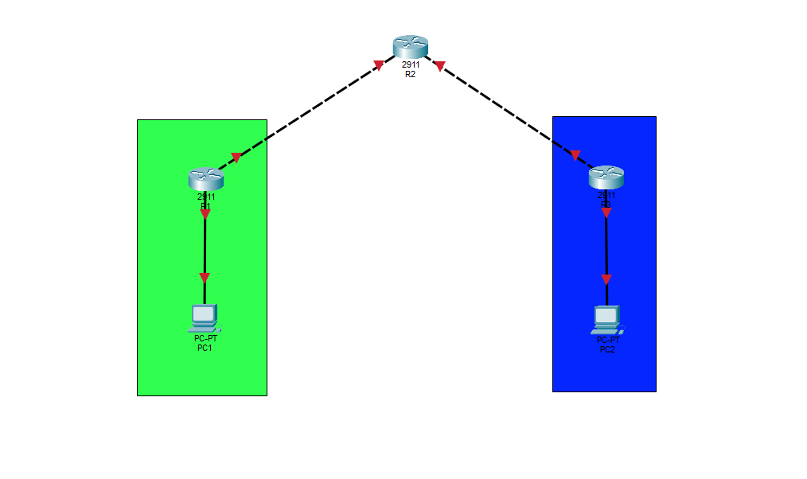
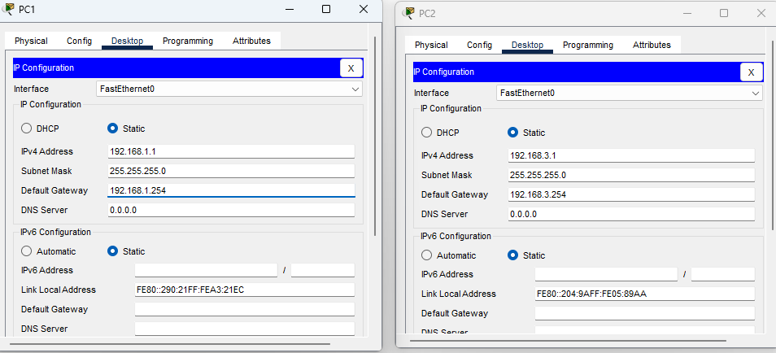
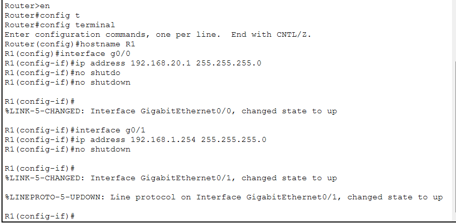
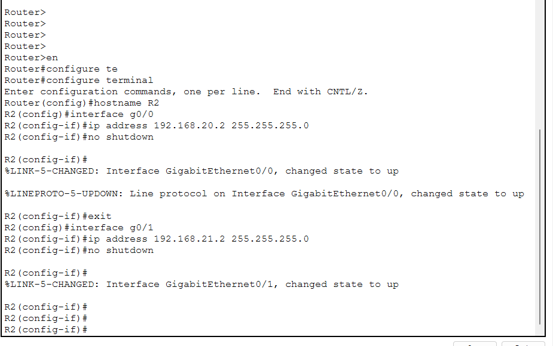
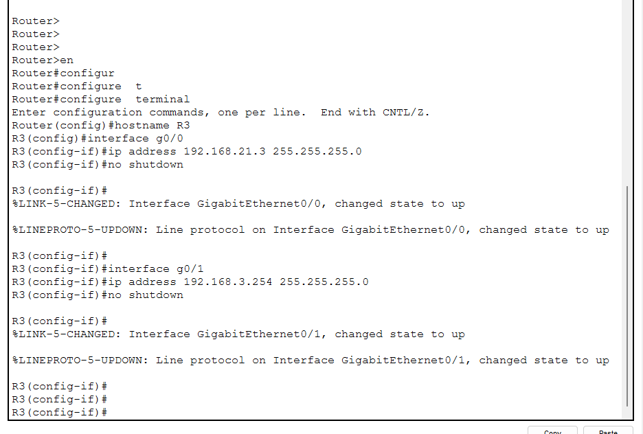
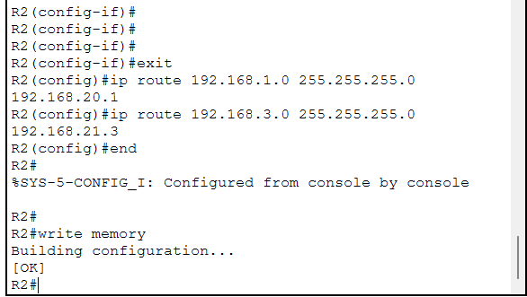
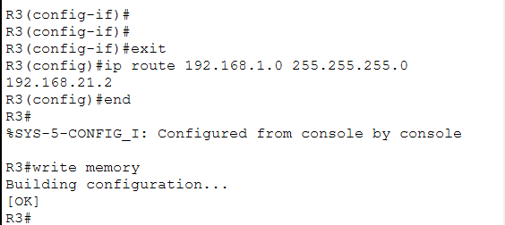
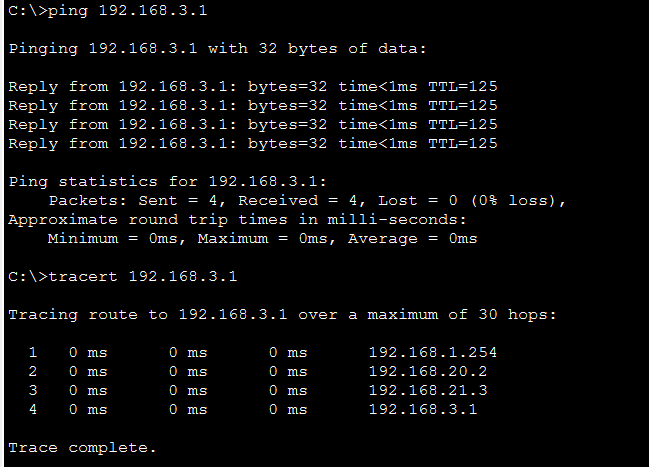

# Lab 02 – Static Routing Between Three Routers

## Objective

Build a three-router network in Cisco Packet Tracer, configure IPv4 addresses on router interfaces and PCs, implement static routes, and verify end-to-end connectivity between two LANs.

## Tools and Components

| Component | Model / Type | Device Name | Quantity |
|---|---|---|---:|
| Router | Cisco 2911 | R1, R2, R3 | 3 |
| End Device | PC-PT | PC1, PC2 | 2 |
| Ethernet Cable | Copper Cross-Over | Router-to-Router | 2 |
| Ethernet Cable | Copper Straight-Through | PC-to-Router | 2 |
| Network Simulator | Cisco Packet Tracer | - | 1 |

## Network Topology

The topology contains three Cisco 2911 routers connected in a line. PC1 connects to R1, while PC2 connects to R3. R2 acts as the intermediate router between the two LANs.



## Cable Connections and Interface IP Addresses

| No. | Device A | Interface | IP Address | Cable Type | Device B | Interface | IP Address |
|---:|---|---|---|---|---|---|---|
| 1 | PC1 | FastEthernet0 | 192.168.1.1/24 | Straight-Through | R1 | GigabitEthernet0/1 | 192.168.1.254/24 |
| 2 | R1 | GigabitEthernet0/0 | 192.168.20.1/24 | Cross-Over | R2 | GigabitEthernet0/0 | 192.168.20.2/24 |
| 3 | R2 | GigabitEthernet0/1 | 192.168.21.2/24 | Cross-Over | R3 | GigabitEthernet0/0 | 192.168.21.3/24 |
| 4 | R3 | GigabitEthernet0/1 | 192.168.3.254/24 | Straight-Through | PC2 | FastEthernet0 | 192.168.3.1/24 |

**Subnet Mask:** 255.255.255.0 (/24)

## IP Addressing

| Device | Interface | IPv4 Address | Subnet Mask | Default Gateway |
|---|---|---|---|---|
| PC1 | FastEthernet0 | 192.168.1.1 | 255.255.255.0 | 192.168.1.254 |
| R1 | GigabitEthernet0/1 | 192.168.1.254 | 255.255.255.0 | - |
| R1 | GigabitEthernet0/0 | 192.168.20.1 | 255.255.255.0 | - |
| R2 | GigabitEthernet0/0 | 192.168.20.2 | 255.255.255.0 | - |
| R2 | GigabitEthernet0/1 | 192.168.21.2 | 255.255.255.0 | - |
| R3 | GigabitEthernet0/0 | 192.168.21.3 | 255.255.255.0 | - |
| R3 | GigabitEthernet0/1 | 192.168.3.254 | 255.255.255.0 | - |
| PC2 | FastEthernet0 | 192.168.3.1 | 255.255.255.0 | 192.168.3.254 |

The network consists of four subnets:

- LAN 1: 192.168.1.0/24
- R1–R2: 192.168.20.0/24
- R2–R3: 192.168.21.0/24
- LAN 2: 192.168.3.0/24



## Router Interface Configuration

### R1 Configuration

```cisco
enable
configure terminal
hostname R1

interface gigabitEthernet 0/0
ip address 192.168.20.1 255.255.255.0
no shutdown
exit

interface gigabitEthernet 0/1
ip address 192.168.1.254 255.255.255.0
no shutdown
exit

end
write memory
```



### R2 Configuration

```cisco
enable
configure terminal
hostname R2

interface gigabitEthernet 0/0
ip address 192.168.20.2 255.255.255.0
no shutdown
exit

interface gigabitEthernet 0/1
ip address 192.168.21.2 255.255.255.0
no shutdown
exit

end
write memory
```



### R3 Configuration

```cisco
enable
configure terminal
hostname R3

interface gigabitEthernet 0/0
ip address 192.168.21.3 255.255.255.0
no shutdown
exit

interface gigabitEthernet 0/1
ip address 192.168.3.254 255.255.255.0
no shutdown
exit

end
write memory
```



## Static Routing Configuration

Static routes were configured to enable communication between the two LAN networks.

### R1 – Route to LAN 2

```cisco
enable
configure terminal
ip route 192.168.3.0 255.255.255.0 192.168.20.2
end
write memory
```


### R2 – Routes to Both LANs

```cisco
enable
configure terminal

ip route 192.168.1.0 255.255.255.0 192.168.20.1
ip route 192.168.3.0 255.255.255.0 192.168.21.3

end
write memory
```



### R3 – Route to LAN 1

```cisco
enable
configure terminal
ip route 192.168.1.0 255.255.255.0 192.168.21.2
end
write memory
```



## Connectivity Verification

Connectivity was tested from PC1 to PC2 using ICMP:

```cmd
ping 192.168.3.1
```

The test completed successfully:

- Packets Sent: 4
- Packets Received: 4
- Packet Loss: 0%



## Traceroute Verification

The network path was verified using:

```cmd
tracert 192.168.3.1
```

The traceroute showed the following path:

| Hop | IP Address | Device |
|---:|---|---|
| 1 | 192.168.1.254 | R1 |
| 2 | 192.168.20.2 | R2 |
| 3 | 192.168.21.3 | R3 |
| 4 | 192.168.3.1 | PC2 |

## Verification Commands

The following commands were used to verify router configuration and connectivity.

**Router Commands**

```cisco
show ip interface brief
show ip route
show running-config
```

**PC Commands**

```cmd
ping 192.168.3.1
tracert 192.168.3.1
```

## Concepts Practised

- Cisco Packet Tracer topology construction
- Cisco 2911 router configuration
- IPv4 addressing and subnet masks
- Default gateway configuration
- Router interface configuration
- Enabling interfaces using `no shutdown`
- Static routing using `ip route`
- Next-hop routing
- Routing table inspection
- ICMP connectivity testing
- Traceroute path verification

## Result

Successfully configured static routing across three Cisco 2911 routers and established communication between PC1 (192.168.1.1) and PC2 (192.168.3.1).

The ping test achieved 0% packet loss, and traceroute confirmed the expected packet path through R1, R2, and R3.


