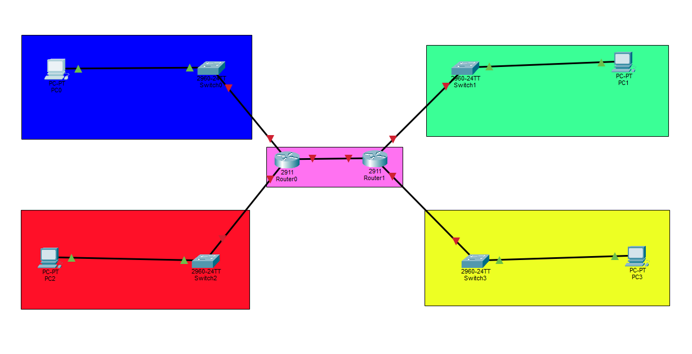
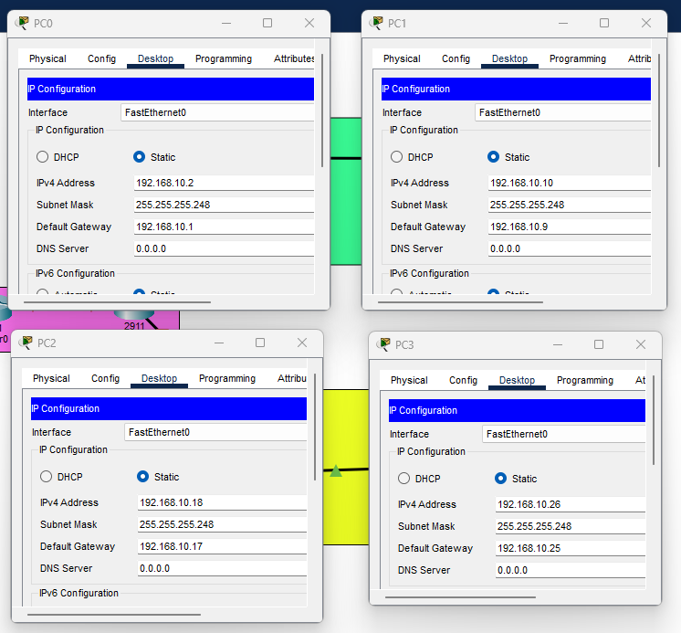
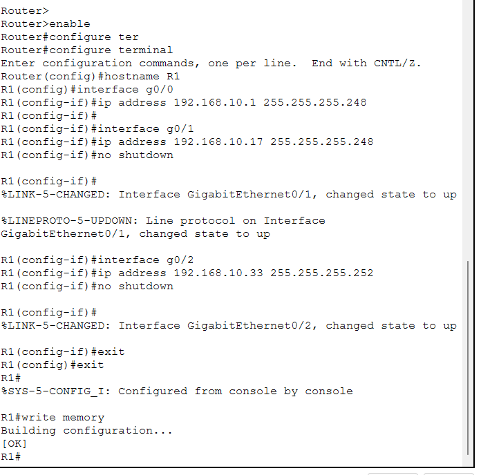
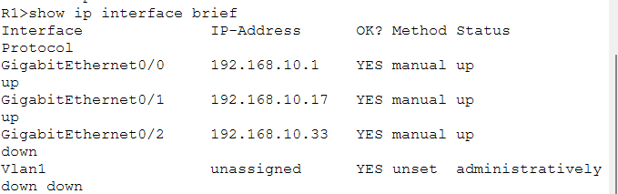
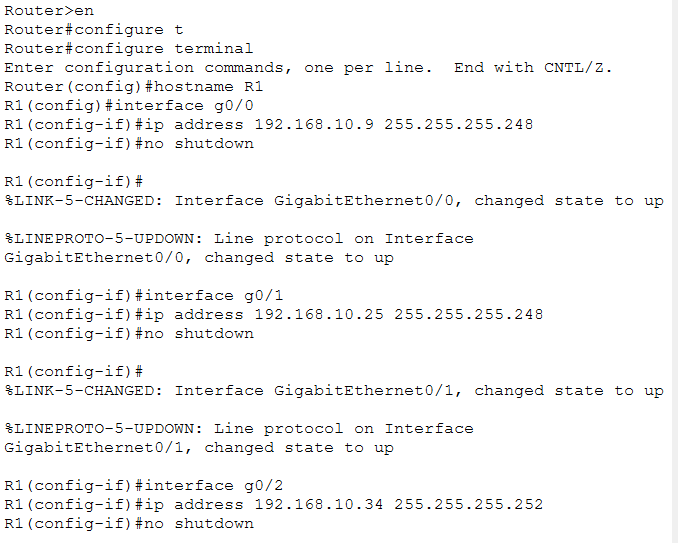
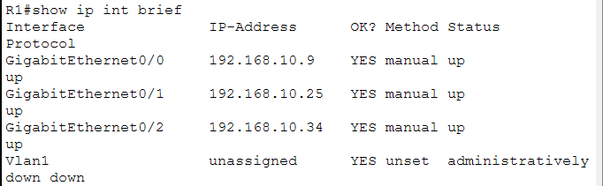
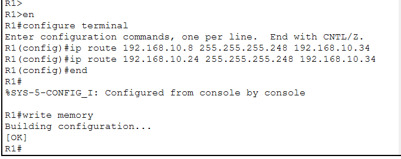
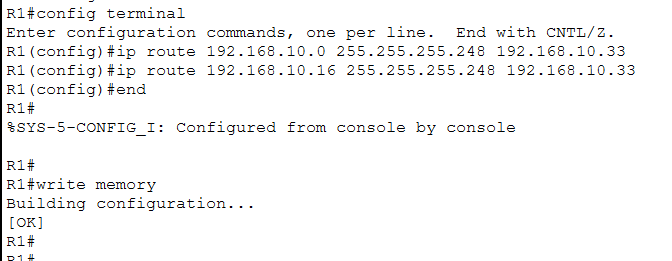
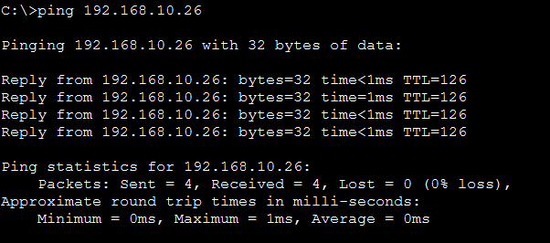

# Lab 05 -- Subnetting (FLSM and VLSM) with Static Routing

## Objective

Build a four-LAN network in Cisco Packet Tracer using two Cisco 2911 routers and four Cisco 2960 switches. Configure IPv4 addressing on the PCs and router interfaces, connect the routers through a point-to-point network, configure static routes, and verify end-to-end connectivity between the LANs.

This lab demonstrates subnet allocation, default gateways, router interface configuration, static routing, and connectivity verification.

## Tools and Components

| Component | Quantity |
|---|---:|
| Cisco 2911 router | 2 |
| Cisco 2960-24TT switch | 4 |
| PC-PT | 4 |
| Copper Ethernet cables | 9 |
| Cisco Packet Tracer | 1 |

## Network Topology

The topology contains four LANs connected through two routers:

- Blue LAN (LAN 1) and Red LAN (LAN 3) connect to Router0.
- Green LAN (LAN 2) and Yellow LAN (LAN 4) connect to Router1.
- Router0 and Router1 are connected through the Pink point-to-point network.



## Cable Connections

| Device A | Interface | Device B | Interface | Cable |
|---|---|---|---|---|
| PC0 | FastEthernet0 | Switch0 | FastEthernet0/1 | Copper Straight-Through |
| Switch0 | FastEthernet0/24 | Router0 | GigabitEthernet0/0 | Copper Straight-Through |
| PC1 | FastEthernet0 | Switch1 | FastEthernet0/1 | Copper Straight-Through |
| Switch1 | FastEthernet0/24 | Router1 | GigabitEthernet0/0 | Copper Straight-Through |
| PC2 | FastEthernet0 | Switch2 | FastEthernet0/1 | Copper Straight-Through |
| Switch2 | FastEthernet0/24 | Router0 | GigabitEthernet0/1 | Copper Straight-Through |
| PC3 | FastEthernet0 | Switch3 | FastEthernet0/1 | Copper Straight-Through |
| Switch3 | FastEthernet0/24 | Router1 | GigabitEthernet0/1 | Copper Straight-Through |
| Router0 | GigabitEthernet0/2 | Router1 | GigabitEthernet0/2 | Copper Cross-Over |

The four switches operate as Layer 2 access switches. No switch CLI configuration is required for this basic routed-LAN lab.

## IP Addressing

### Configured Addressing Plan

The captured Packet Tracer configuration uses the `192.168.10.0/24` address block. Each LAN is configured with a `/29` subnet, and the router-to-router link uses a `/30` subnet.

| Network | Network ID | Subnet Mask | Usable IP Range | Broadcast |
|---|---|---|---|---|
| Blue LAN (LAN 1) | `192.168.10.0/29` | `255.255.255.248` | `192.168.10.1 - 192.168.10.6` | `192.168.10.7` |
| Green LAN (LAN 2) | `192.168.10.8/29` | `255.255.255.248` | `192.168.10.9 - 192.168.10.14` | `192.168.10.15` |
| Red LAN (LAN 3) | `192.168.10.16/29` | `255.255.255.248` | `192.168.10.17 - 192.168.10.22` | `192.168.10.23` |
| Yellow LAN (LAN 4) | `192.168.10.24/29` | `255.255.255.248` | `192.168.10.25 - 192.168.10.30` | `192.168.10.31` |
| Pink WAN | `192.168.10.32/30` | `255.255.255.252` | `192.168.10.33 - 192.168.10.34` | `192.168.10.35` |

### Router Interface Addressing

| Router | Interface | Connected Network | IPv4 Address | Subnet Mask |
|---|---|---|---|---|
| Router0 | GigabitEthernet0/0 | Blue LAN | `192.168.10.1` | `255.255.255.248` |
| Router0 | GigabitEthernet0/1 | Red LAN | `192.168.10.17` | `255.255.255.248` |
| Router0 | GigabitEthernet0/2 | Pink WAN | `192.168.10.33` | `255.255.255.252` |
| Router1 | GigabitEthernet0/0 | Green LAN | `192.168.10.9` | `255.255.255.248` |
| Router1 | GigabitEthernet0/1 | Yellow LAN | `192.168.10.25` | `255.255.255.248` |
| Router1 | GigabitEthernet0/2 | Pink WAN | `192.168.10.34` | `255.255.255.252` |

### PC IP Addressing and Default Gateways

| PC | LAN | Interface | IPv4 Address | Subnet Mask | Default Gateway |
|---|---|---|---|---|---|
| PC0 | Blue | FastEthernet0 | `192.168.10.2` | `255.255.255.248` | `192.168.10.1` |
| PC1 | Green | FastEthernet0 | `192.168.10.10` | `255.255.255.248` | `192.168.10.9` |
| PC2 | Red | FastEthernet0 | `192.168.10.18` | `255.255.255.248` | `192.168.10.17` |
| PC3 | Yellow | FastEthernet0 | `192.168.10.26` | `255.255.255.248` | `192.168.10.25` |



## Router Configuration

The router interfaces were assigned IPv4 addresses and enabled using `no shutdown`. The router hostnames in the saved configurations are Router0 and Router1.

### Router0 Configuration

```cisco
enable
configure terminal
hostname Router0

interface gigabitEthernet 0/0
description BLUE_LAN
ip address 192.168.10.1 255.255.255.248
no shutdown
exit

interface gigabitEthernet 0/1
description RED_LAN
ip address 192.168.10.17 255.255.255.248
no shutdown
exit

interface gigabitEthernet 0/2
description ROUTER_TO_ROUTER
ip address 192.168.10.33 255.255.255.252
no shutdown
exit

end
write memory
```





### Router1 Configuration

```cisco
enable
configure terminal
hostname Router1

interface gigabitEthernet 0/0
description GREEN_LAN
ip address 192.168.10.9 255.255.255.248
no shutdown
exit

interface gigabitEthernet 0/1
description YELLOW_LAN
ip address 192.168.10.25 255.255.255.248
no shutdown
exit

interface gigabitEthernet 0/2
description ROUTER_TO_ROUTER
ip address 192.168.10.34 255.255.255.252
no shutdown
exit

end
write memory
```





## Static Routing Configuration

Static routes were configured so each router can forward traffic to the LANs connected to the other router. The next-hop address is the IP address of the neighbouring router on the Pink WAN network.

### Router0 -- Routes to Green and Yellow LANs

```cisco
enable
configure terminal

ip route 192.168.10.8 255.255.255.248 192.168.10.34
ip route 192.168.10.24 255.255.255.248 192.168.10.34

end
write memory
```

### Router1 -- Routes to Blue and Red LANs

```cisco
enable
configure terminal

ip route 192.168.10.0 255.255.255.248 192.168.10.33
ip route 192.168.10.16 255.255.255.248 192.168.10.33

end
write memory
```





## Connectivity Verification

Connectivity was tested from PC0 to PC3 using ICMP:

```text
ping 192.168.10.26
```

The captured ping test completed successfully:

- Packets sent: 4
- Packets received: 4
- Packet loss: 0%



## Verification Commands

Use these commands on both routers to inspect interface status, routing information, and saved configuration:

```cisco
show ip interface brief
show ip route
show running-config
```

Use these commands from the PCs to verify connectivity:

```text
ipconfig
ping <destination-ip>
tracert <destination-ip>
```

## Concepts Practised

- Cisco Packet Tracer topology construction
- IPv4 subnetting and subnet masks
- VLSM allocation with different subnet sizes for LANs and a point-to-point WAN
- PC IPv4 address and default gateway configuration
- Cisco 2911 router interface configuration
- Cisco 2960 Layer 2 switch connectivity
- Enabling router interfaces with `no shutdown`
- Static route configuration using `ip route`
- Next-hop routing
- Routing-table inspection
- ICMP ping testing and packet-loss verification

## Result

Configured a four-LAN network using two Cisco 2911 routers and four Cisco 2960 switches. IPv4 addressing was assigned to all four PCs and router interfaces, and static routes were added between the routers. The captured end-to-end ping from PC0 (`192.168.10.2`) to PC3 (`192.168.10.26`) succeeded with 4 packets received and 0% packet loss.

## Important VLSM Capacity Note

The screenshots included with this lab document the working `/29` LAN configuration. A `/29` subnet provides only 6 usable host addresses per LAN, so this captured configuration does **not** yet demonstrate the later proposed allocation for 255 end devices across the four LANs.

For the 255-device design, the planned distribution is Blue: 100, Green: 75, Red: 50, and Yellow: 30 end devices. That design requires `/25`, `/25`, `/26`, and `/26` LAN subnets respectively, plus a `/30` WAN subnet. The router, PC, and static-route configurations and screenshots must be updated to those networks before claiming the 255-device VLSM design is implemented.

## Evidence and Lab Files

- Screenshots are stored in the `screenshots/` directory.
- Store the Cisco Packet Tracer project file in this lab directory, for example as `vlsm-static-routing.pkt`.
- Keep the router configuration text files alongside the README if exported separately.
