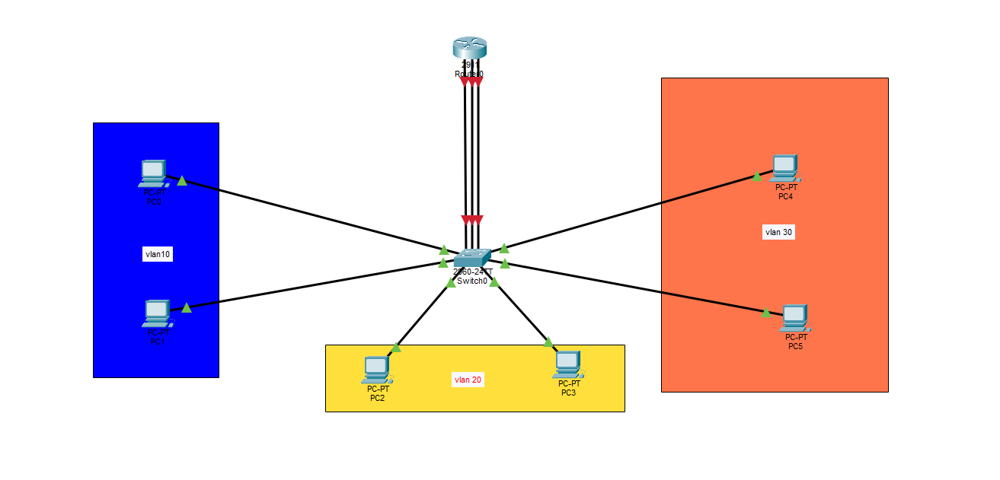
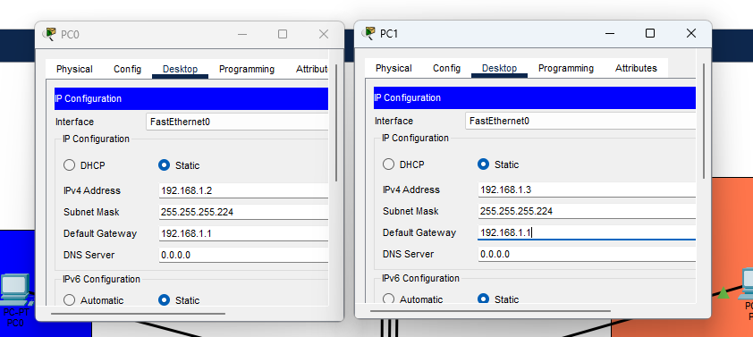
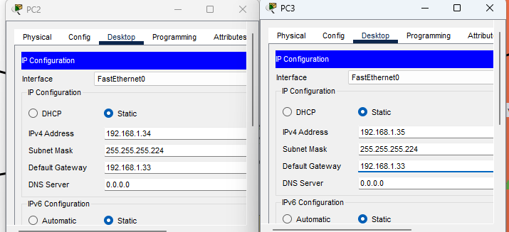
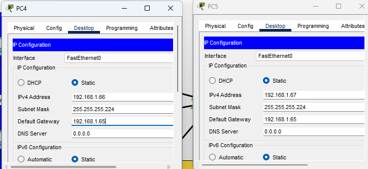
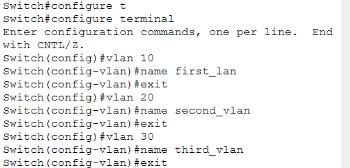
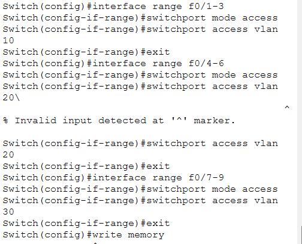
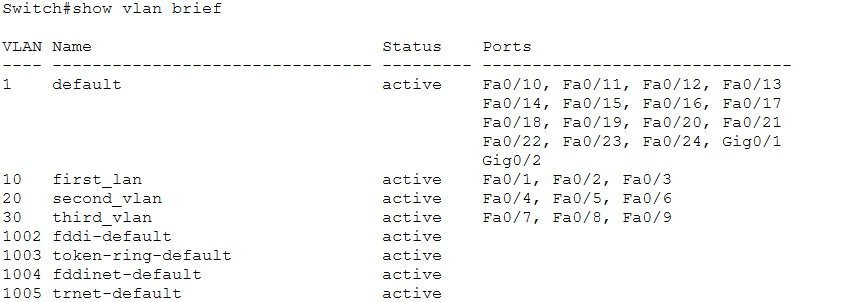
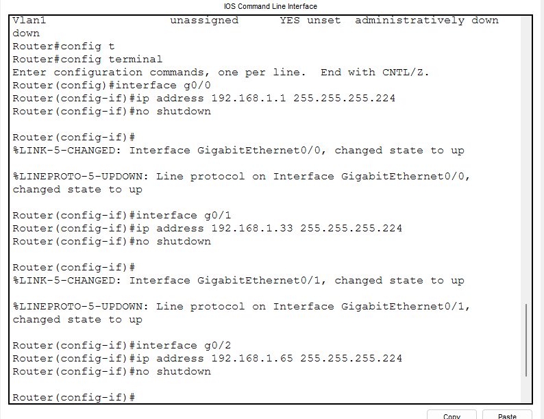
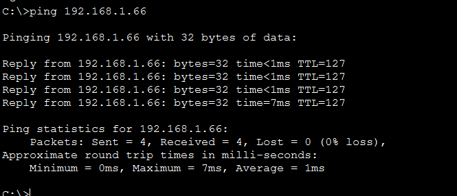

# Lab 07 – Inter-VLAN Routing Using Multiple Physical Router Interfaces

## Objective

Create three separate VLANs on one Cisco 2960 switch, connect the switch to a Cisco 2911 router using three separate physical interfaces, and enable communication between the VLANs through router-based inter-VLAN routing.

The lab uses subnetting to divide the parent network `192.168.1.0/24` into three `/27` networks.

## Tools and Components

| Component | Quantity |
|---|---:|
| Cisco 2911 router | 1 |
| Cisco 2960 switch | 1 |
| PC-PT | 6 |
| Copper Straight-Through cables | 9 |
| Cisco Packet Tracer | 1 |

## Network Topology

The topology contains three VLANs. Each VLAN has two PCs and one switch port connected to a dedicated physical router interface. The router-facing switch ports are configured as access ports in their respective VLANs.

This design does **not** use a trunk link, 802.1Q tagging, or router subinterfaces.



### Cable Connections

| Device A | Interface | Device B | Interface | VLAN |
|---|---|---|---|---:|
| PC0 | FastEthernet0 | SW1 | Fa0/1 | 10 |
| PC1 | FastEthernet0 | SW1 | Fa0/2 | 10 |
| R1 | GigabitEthernet0/0 | SW1 | Fa0/3 | 10 |
| PC2 | FastEthernet0 | SW1 | Fa0/4 | 20 |
| PC3 | FastEthernet0 | SW1 | Fa0/5 | 20 |
| R1 | GigabitEthernet0/1 | SW1 | Fa0/6 | 20 |
| PC4 | FastEthernet0 | SW1 | Fa0/7 | 30 |
| PC5 | FastEthernet0 | SW1 | Fa0/8 | 30 |
| R1 | GigabitEthernet0/2 | SW1 | Fa0/9 | 30 |

All listed links use Copper Straight-Through cables.

## Subnetting and IP Addressing

### Parent Network

| Parameter | Value |
|---|---|
| Parent network | 192.168.1.0/24 |
| Parent subnet mask | 255.255.255.0 |
| Subnet mask used | 255.255.255.224 |
| Prefix length | /27 |
| Addresses per subnet | 32 |
| Usable host addresses per subnet | 30 |
| Block size | 32 |

The `/24` parent network is divided into three `/27` subnets. Each VLAN is assigned a different subnet.

### Subnet Allocation

| VLAN | Network address | First usable | Last usable | Broadcast address |
|---|---|---|---|---|
| VLAN 10 | 192.168.1.0/27 | 192.168.1.1 | 192.168.1.30 | 192.168.1.31 |
| VLAN 20 | 192.168.1.32/27 | 192.168.1.33 | 192.168.1.62 | 192.168.1.63 |
| VLAN 30 | 192.168.1.64/27 | 192.168.1.65 | 192.168.1.94 | 192.168.1.95 |

### Device IP Addressing

| Device | VLAN | IPv4 address | Subnet mask | Default gateway |
|---|---:|---|---|---|
| R1 G0/0 | 10 | 192.168.1.1 | 255.255.255.224 | — |
| PC0 | 10 | 192.168.1.2 | 255.255.255.224 | 192.168.1.1 |
| PC1 | 10 | 192.168.1.3 | 255.255.255.224 | 192.168.1.1 |
| R1 G0/1 | 20 | 192.168.1.33 | 255.255.255.224 | — |
| PC2 | 20 | 192.168.1.34 | 255.255.255.224 | 192.168.1.33 |
| PC3 | 20 | 192.168.1.35 | 255.255.255.224 | 192.168.1.33 |
| R1 G0/2 | 30 | 192.168.1.65 | 255.255.255.224 | — |
| PC4 | 30 | 192.168.1.66 | 255.255.255.224 | 192.168.1.65 |
| PC5 | 30 | 192.168.1.67 | 255.255.255.224 | 192.168.1.65 |







## Switch Configuration

### VLAN Creation

| VLAN ID | VLAN name | Purpose |
|---:|---|---|
| 10 | first_lan | First LAN |
| 20 | second_vlan | Second LAN |
| 30 | third_vlan | Third LAN |

```cisco
enable
configure terminal

vlan 10
 name first_lan
exit

vlan 20
 name second_vlan
exit

vlan 30
 name third_vlan
exit
```



### Access Port Assignment

The PC-facing ports and router-facing ports are all assigned as access ports in the corresponding VLAN.

| Interface range | Mode | Access VLAN | Connected devices |
|---|---|---:|---|
| Fa0/1–Fa0/3 | Access | 10 | PC0, PC1, R1 G0/0 |
| Fa0/4–Fa0/6 | Access | 20 | PC2, PC3, R1 G0/1 |
| Fa0/7–Fa0/9 | Access | 30 | PC4, PC5, R1 G0/2 |

```cisco
configure terminal

interface range fa0/1-3
 switchport mode access
 switchport access vlan 10
exit

interface range fa0/4-6
 switchport mode access
 switchport access vlan 20
exit

interface range fa0/7-9
 switchport mode access
 switchport access vlan 30
exit

end
write memory
```



### Switch Verification

```cisco
show vlan brief
```

Expected port membership:

| VLAN | Name | Ports |
|---:|---|---|
| 10 | first_lan | Fa0/1, Fa0/2, Fa0/3 |
| 20 | second_vlan | Fa0/4, Fa0/5, Fa0/6 |
| 30 | third_vlan | Fa0/7, Fa0/8, Fa0/9 |



## Router Configuration

The router uses three separate physical interfaces. Each interface is assigned an IP address from the subnet used by its connected VLAN.

| Router interface | Switch interface | VLAN | IPv4 address | Subnet mask |
|---|---|---:|---|---|
| G0/0 | Fa0/3 | 10 | 192.168.1.1 | 255.255.255.224 |
| G0/1 | Fa0/6 | 20 | 192.168.1.33 | 255.255.255.224 |
| G0/2 | Fa0/9 | 30 | 192.168.1.65 | 255.255.255.224 |

```cisco
enable
configure terminal

interface gigabitEthernet 0/0
 ip address 192.168.1.1 255.255.255.224
 no shutdown
exit

interface gigabitEthernet 0/1
 ip address 192.168.1.33 255.255.255.224
 no shutdown
exit

interface gigabitEthernet 0/2
 ip address 192.168.1.65 255.255.255.224
 no shutdown
exit

end
write memory
```



### Router Verification Commands

```cisco
show ip interface brief
show ip route
```

The routing table should contain these three directly connected networks:

- `192.168.1.0/27`
- `192.168.1.32/27`
- `192.168.1.64/27`

## Connectivity Verification

From PC0, the following test was performed to reach PC4 in VLAN 30:

```text
ping 192.168.1.66
```

The captured result shows 4 packets sent, 4 received, and 0% packet loss.



Additional recommended tests:

| Source | Destination | Test type |
|---|---|---|
| PC0 (192.168.1.2) | PC1 (192.168.1.3) | Same-VLAN connectivity |
| PC0 (192.168.1.2) | PC2 (192.168.1.34) | Inter-VLAN: VLAN 10 to 20 |
| PC0 (192.168.1.2) | PC4 (192.168.1.66) | Inter-VLAN: VLAN 10 to 30 |
| PC4 (192.168.1.66) | PC2 (192.168.1.34) | Inter-VLAN: VLAN 30 to 20 |

## Concepts Practised

- VLAN creation and naming
- Switch access port configuration
- Assigning router-facing switch ports to VLANs
- IPv4 subnetting using `/27`
- Dividing a `/24` parent network into smaller subnets
- Default gateway configuration
- Inter-VLAN routing using multiple physical router interfaces
- Router interface configuration and `no shutdown`
- VLAN verification using `show vlan brief`
- Connectivity verification using ICMP ping


