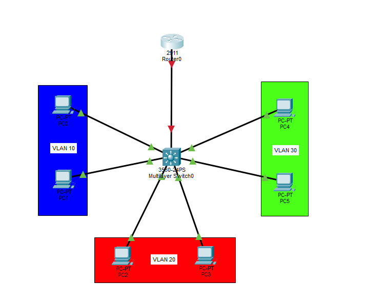
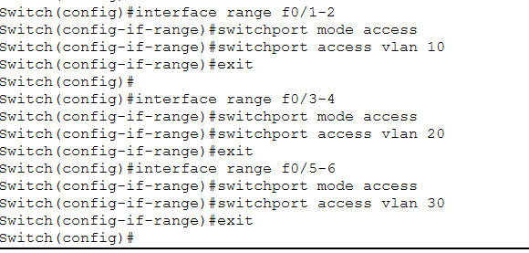
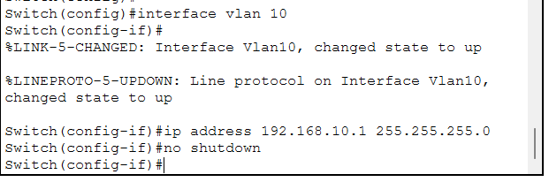

## 6. Practical Implementation & Evidence

### 6.1 Network Topology

The network consists of one Cisco 2911 router, one Cisco 3560 multilayer switch and six PCs distributed across three VLANs.

### 6.2 PC IP Address Configuration

Static IP addresses and default gateways were configured for all six PCs.

### 6.3 VLAN Creation

Created VLAN 10, VLAN 20 and VLAN 30 on the multilayer switch.

### 6.4 Switch Port Assignment

Assigned access ports to their respective VLANs.

### 6.5 SVI Configuration – VLAN 10

Configured the Switch Virtual Interface for VLAN 10 with gateway address 192.168.10.1/24.

### 6.6 SVI Configuration – VLAN 20

Configured the Switch Virtual Interface for VLAN 20 with gateway address 192.168.20.1/24.

### 6.7 SVI Configuration – VLAN 30

Configured the Switch Virtual Interface for VLAN 30 with gateway address 192.168.30.1/24.

### 6.8 Router Configuration

Router interface and routing configuration evidence.

### 6.9 Gateway Connectivity Verification

Successfully verified connectivity between a PC and the VLAN 30 SVI gateway (192.168.30.1).

---

## 7. Additional Verification Evidence

The following screenshots will be added after completing the remaining verification tests.

| Screenshot | Verification |
|---|---|
| 10-ip-routing-enabled.png | Layer 3 routing enabled using `ip routing` |
| 11-svi-and-uplink-status.png | SVI and routed interface status |
| 12-switch-routing-table.png | Connected VLAN routes |
| 13-cross-vlan-ping-tests.png | End-to-end inter-VLAN connectivity |
| 14-router-routes.png | Router static routing table |

## 8. Learning Outcomes

- Created and configured multiple VLANs.
- Assigned access ports to their respective VLANs.
- Configured Switch Virtual Interfaces (SVIs).
- Implemented inter-VLAN routing using a Layer 3 switch.
- Enabled IP routing on a multilayer switch.
- Configured routed switch-to-router connectivity.
- Implemented static routing.
- Verified connectivity using ICMP and routing table commands.

## 9. Packet Tracer Project

**Project file:** `ROUTING WITH SVI.pkt`

The Cisco Packet Tracer project file is included in this repository folder.
