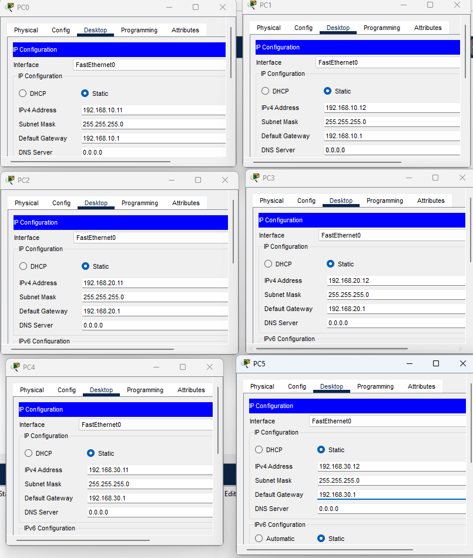
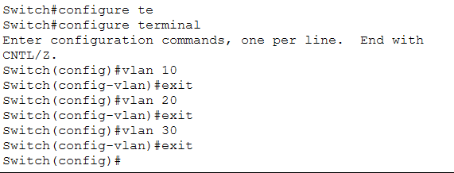
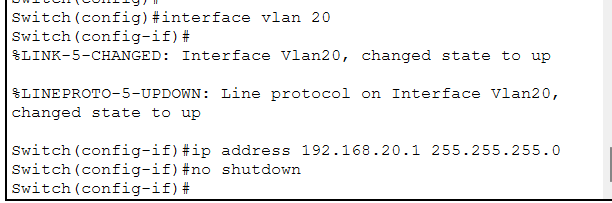
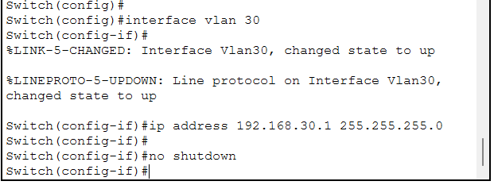
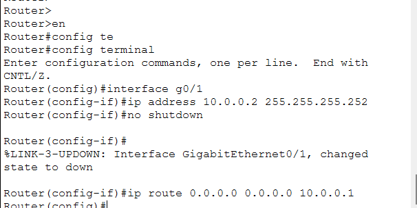
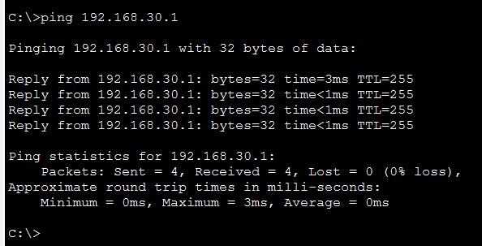

# Inter-VLAN Routing Using Switch Virtual Interfaces (SVI)

**Lab No:** 07  
**Domain:** Computer Networks – CCNA  
**Platform:** Cisco Packet Tracer  
**Main Topic:** Inter-VLAN Routing Using SVI on a Layer 3 Switch

---

## 1. Objective

To implement Inter-VLAN Routing using Switch Virtual Interfaces (SVI) on a Cisco Layer 3 Multilayer Switch.

The objective is to create three separate VLANs, assign two PCs to each VLAN, configure SVIs as default gateways, and enable communication between different VLANs using Layer 3 switching.

A Cisco 2911 router is connected to the multilayer switch through a routed Layer 3 interface to provide upstream connectivity.

---

## 2. Network Architecture

### 2.1 Network Components

| Device | Model | Quantity | Purpose |
|---|---|---|---|
| Router | Cisco 2911 | 1 | Upstream routing |
| Multilayer Switch | Cisco 3560-24PS | 1 | VLAN management and inter-VLAN routing |
| End Devices | PC-PT | 6 | Communication testing |

### 2.2 Network Topology

The network contains three VLANs connected to a single Layer 3 switch.

- VLAN 10 – Two PCs (PC0 and PC1)
- VLAN 20 – Two PCs (PC2 and PC3)
- VLAN 30 – Two PCs (PC4 and PC5)
- Router0 – Connected to the multilayer switch through a routed interface.


---

## 3. VLAN and IP Addressing Plan

Three VLANs were created to logically separate the network into different broadcast domains.

| VLAN ID | VLAN Name | Network Address | Default Gateway |
|---|---|---|---|
| 10 | VLAN10 | 192.168.10.0/24 | 192.168.10.1 |
| 20 | VLAN20 | 192.168.20.0/24 | 192.168.20.1 |
| 30 | VLAN30 | 192.168.30.0/24 | 192.168.30.1 |

**Subnet Mask:** 255.255.255.0

### 3.1 Switch Virtual Interface (SVI) Addressing

| SVI Interface | VLAN | IP Address | Purpose |
|---|---|---|---|
| VLAN 10 | 10 | 192.168.10.1/24 | Gateway for VLAN 10 |
| VLAN 20 | 20 | 192.168.20.1/24 | Gateway for VLAN 20 |
| VLAN 30 | 30 | 192.168.30.1/24 | Gateway for VLAN 30 |

Each SVI acts as the default gateway for its respective VLAN.

---

## 4. PC Addressing and Switch Port Mapping

Each VLAN contains two PCs connected to dedicated access ports on the multilayer switch.

| PC Name | Switch Port | VLAN | IP Address | Subnet Mask | Default Gateway |
|---|---|---|---|---|---|
| PC0 | Fa0/1 | 10 | 192.168.10.11 | 255.255.255.0 | 192.168.10.1 |
| PC1 | Fa0/2 | 10 | 192.168.10.12 | 255.255.255.0 | 192.168.10.1 |
| PC2 | Fa0/3 | 20 | 192.168.20.11 | 255.255.255.0 | 192.168.20.1 |
| PC3 | Fa0/4 | 20 | 192.168.20.12 | 255.255.255.0 | 192.168.20.1 |
| PC4 | Fa0/5 | 30 | 192.168.30.11 | 255.255.255.0 | 192.168.30.1 |
| PC5 | Fa0/6 | 30 | 192.168.30.12 | 255.255.255.0 | 192.168.30.1 |

### 4.1 PC IP Configuration Evidence

Static IP addresses, subnet masks and default gateways were configured on all six PCs.



---

## 5. Switch Configuration

The Cisco 3560 multilayer switch is responsible for VLAN creation, access port assignment, SVI configuration and inter-VLAN routing.

### 5.1 VLAN Creation

Created three VLANs on the multilayer switch.

| VLAN ID | VLAN Name | Assigned Devices |
|---|---|---|
| 10 | VLAN10 | PC0, PC1 |
| 20 | VLAN20 | PC2, PC3 |
| 30 | VLAN30 | PC4, PC5 |

Configuration:

```cisco
enable
configure terminal

vlan 10
name VLAN10
exit

vlan 20
name VLAN20
exit

vlan 30
name VLAN30
exit
```

**Evidence:**



### 5.2 Access Port Assignment

The switch ports were configured as access ports and assigned to their respective VLANs.

| Interface Range | VLAN | Connected PCs |
|---|---|---|
| Fa0/1 – Fa0/2 | 10 | PC0, PC1 |
| Fa0/3 – Fa0/4 | 20 | PC2, PC3 |
| Fa0/5 – Fa0/6 | 30 | PC4, PC5 |

Configuration:

```cisco
interface range fa0/1 - 2
switchport mode access
switchport access vlan 10
exit

interface range fa0/3 - 4
switchport mode access
switchport access vlan 20
exit

interface range fa0/5 - 6
switchport mode access
switchport access vlan 30
exit
```

**Evidence:**


### 5.3 SVI Configuration – VLAN 10

Configured the Switch Virtual Interface for VLAN 10.

```cisco
interface vlan 10
ip address 192.168.10.1 255.255.255.0
no shutdown
exit
```

**Gateway:** 192.168.10.1

**Evidence:**


### 5.4 SVI Configuration – VLAN 20

Configured the Switch Virtual Interface for VLAN 20.

```cisco
interface vlan 20
ip address 192.168.20.1 255.255.255.0
no shutdown
exit
```

**Gateway:** 192.168.20.1

**Evidence:**



### 5.5 SVI Configuration – VLAN 30

Configured the Switch Virtual Interface for VLAN 30.

```cisco
interface vlan 30
ip address 192.168.30.1 255.255.255.0
no shutdown
exit
```

**Gateway:** 192.168.30.1

**Evidence:**



### 5.6 Enable Layer 3 Routing

Enabled IP routing on the multilayer switch.

```cisco
ip routing
```

This command enables the switch to route packets between different VLAN networks using its routing table.

### 5.7 Switch-to-Router Routed Interface

A routed Layer 3 interface is configured between the multilayer switch and the router.

| Device | Interface | IP Address | Subnet Mask |
|---|---|---|---|
| Multilayer Switch | Gi0/1 | 10.0.0.2 | 255.255.255.252 |
| Router0 | Gi0/0 | 10.0.0.1 | 255.255.255.252 |

Switch configuration:

```cisco
interface gigabitEthernet 0/1
no switchport
ip address 10.0.0.2 255.255.255.252
no shutdown
exit
```

### 5.8 Default Route Configuration

Configured a default route on the multilayer switch.

```cisco
ip route 0.0.0.0 0.0.0.0 10.0.0.1
```

This forwards traffic destined for unknown networks to Router0.

---

## 6. Router Configuration

The Cisco 2911 router is connected to the multilayer switch using a routed interface.

### 6.1 Interface Configuration

```cisco
enable
configure terminal

hostname R1

interface gigabitEthernet 0/0
ip address 10.0.0.1 255.255.255.252
no shutdown
exit
```

### 6.2 Static Route Configuration

Configured static routes to reach all three VLAN networks through the multilayer switch.

```cisco
ip route 192.168.10.0 255.255.255.0 10.0.0.2

ip route 192.168.20.0 255.255.255.0 10.0.0.2

ip route 192.168.30.0 255.255.255.0 10.0.0.2
```

### 6.3 Router Configuration Evidence



---

## 7. Verification and Connectivity Testing

Connectivity was tested using ICMP ping commands from the PCs.

### 7.1 Gateway Connectivity Test

From PC0, the VLAN 30 gateway was tested.

Command:

```bash
ping 192.168.30.1
```

**Expected Result:** Successful replies from the VLAN 30 SVI gateway.

**Evidence:**



### 7.2 Additional Inter-VLAN Connectivity Tests

The following tests should be performed to verify communication between different VLANs.

| Source PC | Destination | Test |
|---|---|---|
| PC0 | 192.168.10.12 | Same VLAN communication |
| PC0 | 192.168.20.11 | VLAN 10 to VLAN 20 |
| PC0 | 192.168.30.11 | VLAN 10 to VLAN 30 |
| PC2 | 192.168.30.12 | VLAN 20 to VLAN 30 |
| PC4 | 192.168.10.12 | VLAN 30 to VLAN 10 |

Example:

```bash
ping 192.168.20.11
ping 192.168.30.11
```

### 7.3 Switch Verification Commands

| Command | Purpose |
|---|---|
| `show vlan brief` | Verify VLAN creation and port assignments |
| `show ip interface brief` | Verify SVI and routed interface status |
| `show ip route` | Verify the Layer 3 routing table |
| `show running-config` | Verify switch configuration |
| `show interfaces status` | Verify physical interface status |

### 7.4 Router Verification Commands

| Command | Purpose |
|---|---|
| `show ip interface brief` | Verify router interface status |
| `show ip route` | Verify static routes |
| `show running-config` | Verify router configuration |

### 7.5 Additional Evidence to Capture

| Screenshot | Evidence |
|---|---|
| 10-ip-routing-enabled.png | IP routing enabled |
| 11-svi-and-uplink-status.png | All SVI and routed interface status |
| 12-switch-routing-table.png | Layer 3 switch routing table |
| 13-cross-vlan-ping-tests.png | Successful inter-VLAN PC communication |
| 14-router-routes.png | Router static routing table |

---

## 8. Learning Outcomes

Through this practical implementation, the following concepts were understood and implemented:

- Created and configured multiple VLANs.
- Assigned switch access ports to different VLANs.
- Configured Switch Virtual Interfaces (SVI).
- Used SVIs as default gateways for VLANs.
- Enabled Layer 3 routing using the `ip routing` command.
- Implemented inter-VLAN routing using a multilayer switch.
- Configured routed interfaces between a Layer 3 switch and router.
- Implemented static routing and default routing.
- Verified network connectivity using ICMP ping tests.
- Analysed routing tables and interface status.

---

## 9. Packet Tracer Project Files

| File | Description |
|---|---|
| `ROUTING WITH SVI.pkt` | Cisco Packet Tracer network topology and configuration |
| `README.md` | Lab documentation |
| `screenshots/` | Practical configuration and verification evidence |

The Packet Tracer project file is included in this repository folder.

---

## 10. Conclusion

Successfully designed and configured a network using three VLANs and a Cisco 3560 multilayer switch.

Switch Virtual Interfaces (SVIs) were configured as default gateways, and Layer 3 routing was enabled to facilitate communication between different VLANs.

The lab demonstrates the implementation of SVI-based inter-VLAN routing and the role of a multilayer switch in routing traffic between logically segmented networks.
