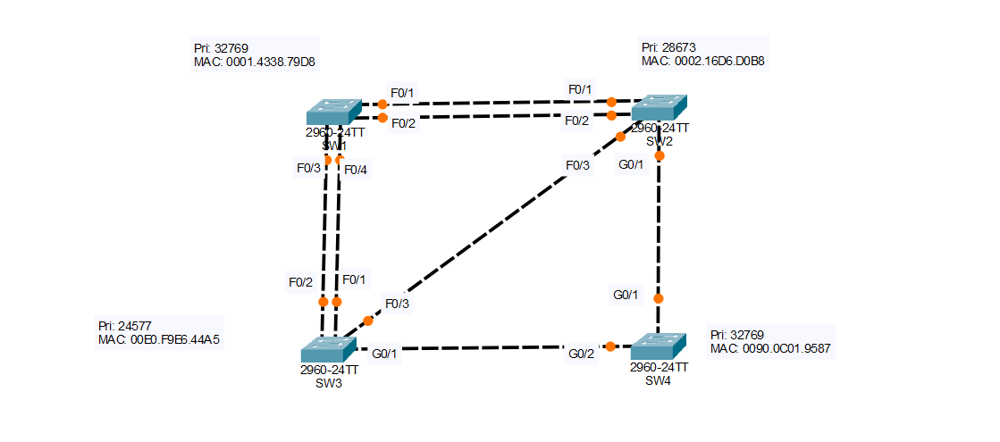
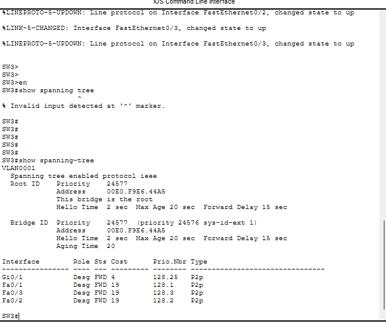
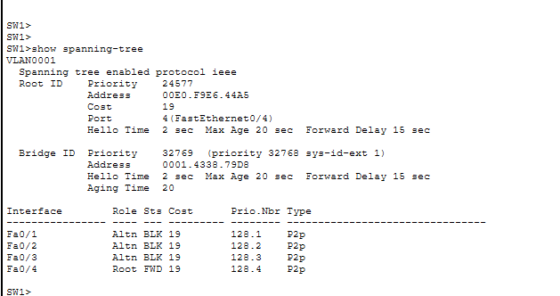
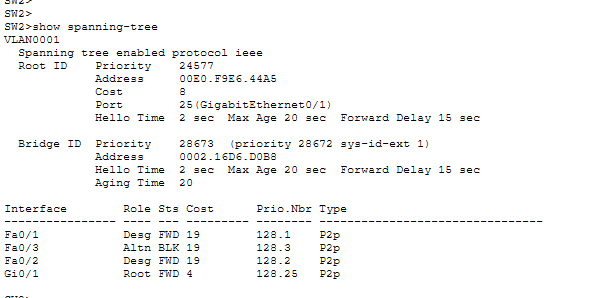
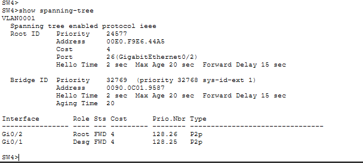

# Spanning Tree Protocol (STP) Fundamentals

## Objective

Build a redundant Layer 2 topology using four Cisco 2960-24TT switches and examine how Spanning Tree Protocol (STP) prevents switching loops. Use the `show spanning-tree` command on each switch to identify the root bridge, root ports, designated ports, and alternate (blocking) ports.

## Tools and Components

| Component | Quantity |
|---|---:|
| Cisco 2960-24TT switch | 4 |
| Cisco Packet Tracer | 1 |
| Ethernet links | As shown in the topology |

## Network Topology

The lab contains four switches arranged with multiple redundant paths. The topology includes parallel FastEthernet links and additional GigabitEthernet links. These redundant Layer 2 paths allow STP to select forwarding paths and place selected redundant ports into an alternate/blocking state.



### Switches

| Switch | Bridge priority shown | MAC address |
|---|---:|---|
| SW1 | 32769 | 0001.4338.79D8 |
| SW2 | 28673 | 0002.16D6.D0B8 |
| SW3 | 24577 | 00E0.F9E6.44A5 |
| SW4 | 32769 | 0090.0C01.9587 |

### Cable Connections

The following connections are labelled in the supplied topology screenshot.

| Device A | Port | Device B | Port |
|---|---|---|---|
| SW1 | Fa0/1 | SW2 | Fa0/1 |
| SW1 | Fa0/2 | SW2 | Fa0/2 |
| SW1 | Fa0/3 | SW3 | Fa0/2 |
| SW1 | Fa0/4 | SW3 | Fa0/1 |
| SW2 | Fa0/3 | SW3 | Fa0/3 |
| SW2 | Gi0/1 | SW4 | Gi0/1 |
| SW3 | Gi0/1 | SW4 | Gi0/2 |

## STP Verification

The following command was run on each switch to inspect the spanning-tree information for the default VLAN (VLAN 1).

```cisco
enable
show spanning-tree
```

The output displays the Root ID, local Bridge ID, root path cost, root port, and the role/state of each participating interface.

## Switch-wise Results

### SW3 – Root Bridge



SW3 is the root bridge for VLAN 1. Its Bridge ID matches the Root ID:

| Field | Observed value |
|---|---|
| Root bridge | SW3 |
| Root ID priority | 24577 |
| Root ID MAC | 00E0.F9E6.44A5 |
| Local Bridge ID priority | 24577 |
| Local Bridge ID MAC | 00E0.F9E6.44A5 |
| Root path cost | 0 (this bridge is the root) |

All listed SW3 interfaces are Designated and Forwarding:

| Interface | Role | State | Cost |
|---|---|---|---:|
| Gi0/1 | Designated | Forwarding | 4 |
| Fa0/1 | Designated | Forwarding | 19 |
| Fa0/3 | Designated | Forwarding | 19 |
| Fa0/2 | Designated | Forwarding | 19 |

A root bridge has no root port. Its active ports are designated ports for their respective segments.

### SW1 – Root Port and Alternate Ports



SW1 receives its best path to the root bridge through FastEthernet0/4.

| Field | Observed value |
|---|---|
| Root bridge MAC | 00E0.F9E6.44A5 |
| Root path cost | 19 |
| Root port | Fa0/4 |
| Local Bridge ID priority | 32769 |
| Local Bridge ID MAC | 0001.4338.79D8 |

| Interface | Role | State | Cost |
|---|---|---|---:|
| Fa0/1 | Alternate | Blocking | 19 |
| Fa0/2 | Alternate | Blocking | 19 |
| Fa0/3 | Alternate | Blocking | 19 |
| Fa0/4 | Root | Forwarding | 19 |

The three Alternate/Blocking ports prevent redundant paths from creating Layer 2 loops. Fa0/4 is the Root/Forwarding port because it provides SW1's selected path towards SW3.

### SW2 – Root Port and Alternate Port



SW2 reaches the root bridge through GigabitEthernet0/1.

| Field | Observed value |
|---|---|
| Root bridge MAC | 00E0.F9E6.44A5 |
| Root path cost | 8 |
| Root port | Gi0/1 |
| Local Bridge ID priority | 28673 |
| Local Bridge ID MAC | 0002.16D6.D0B8 |

| Interface | Role | State | Cost |
|---|---|---|---:|
| Fa0/1 | Designated | Forwarding | 19 |
| Fa0/3 | Alternate | Blocking | 19 |
| Fa0/2 | Designated | Forwarding | 19 |
| Gi0/1 | Root | Forwarding | 4 |

Fa0/3 is shown as Alternate/Blocking. This prevents the redundant direct path from forwarding and forming a loop. Gi0/1 is SW2's selected Root Port.

### SW4 – Root Port and Designated Port



SW4 reaches the root bridge through GigabitEthernet0/2.

| Field | Observed value |
|---|---|
| Root bridge MAC | 00E0.F9E6.44A5 |
| Root path cost | 4 |
| Root port | Gi0/2 |
| Local Bridge ID priority | 32769 |
| Local Bridge ID MAC | 0090.0C01.9587 |

| Interface | Role | State | Cost |
|---|---|---|---:|
| Gi0/2 | Root | Forwarding | 4 |
| Gi0/1 | Designated | Forwarding | 4 |

SW4 uses Gi0/2 as its Root Port towards SW3. Gi0/1 is Designated/Forwarding on the link towards SW2.

## Consolidated STP Results

| Switch | Root bridge? | Root port | Alternate / Blocking ports |
|---|---|---|---|
| SW1 | No | Fa0/4 | Fa0/1, Fa0/2, Fa0/3 |
| SW2 | No | Gi0/1 | Fa0/3 |
| SW3 | Yes | None | None shown |
| SW4 | No | Gi0/2 | None shown |

## Concepts Practised

- Purpose of Spanning Tree Protocol (STP)
- Root bridge election using Bridge ID
- Root ID and local Bridge ID
- Root path cost
- Root Port (RP) selection
- Designated Port (DP) selection
- Alternate port and Blocking state
- Reading `show spanning-tree` output
- How STP prevents Layer 2 switching loops

## Verification Commands

Run these commands in privileged EXEC mode on each switch:

```cisco
enable
show spanning-tree
show spanning-tree vlan 1
show spanning-tree root
```

## Observation

SW3 is the root bridge because its displayed Bridge ID has the lowest priority value among the four switches. The other switches select a Root Port that provides their best path towards SW3. STP places redundant ports into the Alternate/Blocking role where required, while the selected Root and Designated ports remain Forwarding. This creates a loop-free logical Layer 2 topology while retaining physical redundant links.

## Note on Command Entry

On SW3, the first attempt used `show spanning tree` and returned an invalid-input message. The valid Cisco IOS command is:

```cisco
show spanning-tree
```

The successful SW3 output is the one documented above.
